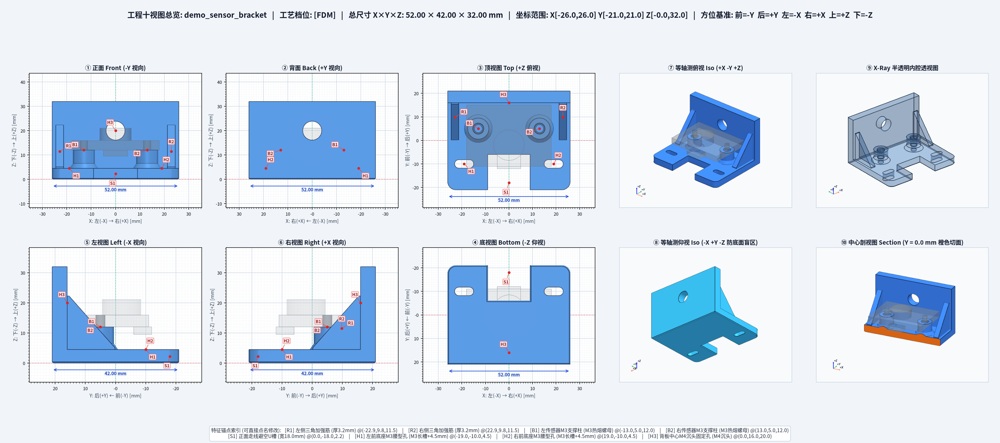
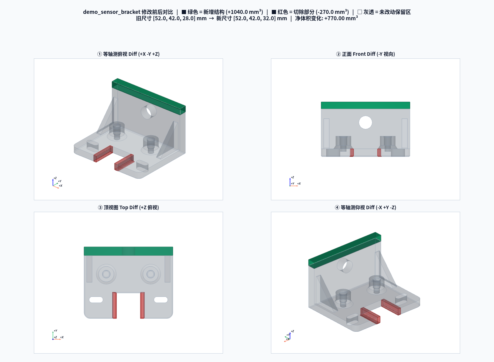

# CAD Studio — Agentic 结构件参数化建模工作站

专为 **AI Agent + 工程师协作设计 STEP / STL 结构件** 打造的独立工作区。内置统一语义坐标协议、双工艺公差引擎（**FDM 3D 打印 / CNC 机加工 / 理论零公差**）、STEP/STL 逆向测绘探针、**10 视图工程总览图**、**修改前后红绿三维 Diff 对比** 以及 **零依赖 WebGL 实时剖切 3D 预览器**。

---

## 一、 核心能力一览

1. **STEP + STL 原生双输出 (`build123d` + `OpenCASCADE`)**：
   - 真 B-Rep 实体建模，导出的 `.step` 可直接拖入 `BambuStudio`（圆弧丝滑无折面）或 SolidWorks / FreeCAD 二次装配；同步导出水密 `.stl`。
2. **参考/修改现有文件 (`cad-cli inspect` + `modify_mesh`)**：
   - 丢入任意现成 `.step` 或 `.stl`，自动提取**包围盒极值、原点偏移警告、各台阶平面高度、圆孔坐标与直径**，并输出 **4 视图毫米标尺截面图**。
   - 支持 **STEP 实体二次布尔改件**、**STL 水密网格开孔/加耳片手术**、**STL 逆向参数化重构转 STEP**，以及**配合件三维干涉防撞检测**。
3. **10 合 1 工程总览图 + 红绿 Diff 图 (`preview_sheet.png` & `diff_sheet.png`)**：
   - **正交六视图**（前、后、顶、底、左、右，零透视畸变 + `1mm/5mm/10mm` 标尺 + 特征 ID 红牌）+ **俯仰双等轴测** + **X-Ray 半透明内腔透视** + **橙色中心实心剖视图**。
   - 每次迭代修改自动生成 **红绿布尔对比图**（🟢 绿色 = 新增体积，🔴 红色 = 切除体积，⚪ 灰透 = 保留区）。
4. **更快更准听懂你的口语修改**：
   - 全项目锁死方位映射：**前=`-Y` ｜ 后=`+Y` ｜ 左=`-X` ｜ 右=`+X` ｜ 上=`+Z` ｜ 下=`-Z`（热床 `Z=0`）**。
   - 每个孔、槽、柱自动注册短编号（如 `[H1]`, `[S1]`, `[B1]`, `[R1]`）投影在图上，可直接点名修改。
   - 预置 `M1.6 ~ M8` 通孔、内六角沉头孔、皿头锥孔、滚花热熔螺母孔、侧面滑入式防转螺母槽、腰型调节槽与三角加强筋。

---

## 二、 实测渲染预览（内置 `demo_sensor_bracket` 演示件）

### 1. 工程十视图总览 (`preview_sheet.png`)


### 2. 修改前后红绿三维布尔对比 (`diff_sheet.png`)


### 3. 现有 STL/STEP 逆向截面测绘 (`sensor_module_inspect_slices.png`)


---

## 三、 日常使用方式（直接对 Agent 说话即可）

克隆仓库并在 Antigravity 中将工作区打开到本仓库根目录 `cad-studio`（会自动加载 `AGENTS.md` 规则与 `.agents/skills/structural-cad` 技能）：

- **从零画件**：
  > “帮我画一个 42 步进电机（NEMA17）L 型固定支架，FDM 打印用，底座用 4 个 M4 腰型调节孔，两侧加加强筋。”
- **参考或修改现有 STL/STEP**：
  > “参考 `refs/board.step`，给它设计一个带卡扣或 M3 热熔螺母柱的下壳，正面留 Type-C 开口，确保不干涉。”
  > “把 `refs/old_part.stl` 拿过来，在底面右侧多加一个 M3 安装耳片，背面中间开个 Ø10 过线孔。”
- **看图极速改件**：
  > “看了一下预览图：把 `H1` 和 `H2` 往前移 2mm，`S1` 开口放宽到 18mm，另外帮我切一份 CNC 攻丝公差版本的 STEP。”

---

## 四、 命令行工具速查 (`cad-cli`)

首次克隆后执行 `uv sync`（自动拉取 Python 3.12 环境及依赖），随后即可运行：

```bash
cd cad-studio
uv sync

# 1. 新建零件工作目录 projects/<name>/part.py
uv run cad-cli init-part my_bracket --mode fdm

# 2. 构建零件（自动输出 .step, .stl, preview_sheet.png, diff_sheet.png, viewer.html, manifest.json）
uv run cad-cli build projects/demo_sensor_bracket/part.py
uv run cad-cli build projects/demo_sensor_bracket/part.py --mode cnc   # 切换 CNC 公差档位构建

# 3. 逆向体检任意现有 STEP / STL 文件
uv run cad-cli inspect projects/demo_sensor_bracket/refs/sensor_module.step --preview

# 4. 对比任意两个新旧模型的三维体积差异
uv run cad-cli diff old.stl new.stl -o diff_sheet.png

# 5. 一键用本机 BambuStudio 打开生成的 STEP 或 STL
uv run cad-cli open-slicer projects/demo_sensor_bracket/out/demo_sensor_bracket.step
```

---

## 五、 目录结构说明

```text
cad-studio/
├── AGENTS.md                        # 常驻全局规则：方位协议、参数化铁律、视觉+几何双重自检闭环
├── pyproject.toml                   # Python 3.12 独立环境配置 (build123d, pyvista, trimesh, manifold3d)
├── .agents/skills/structural-cad/   # Antigravity 结构件专项 Skill 与工程速查手册
│   ├── SKILL.md
│   ├── references/
│   │   ├── fasteners_and_tolerances.md
│   │   └── build123d_cookbook.md
│   └── scripts/run_cli.sh
├── cad_kit/                         # 核心 Python 标准件与渲染引擎库
│   ├── tolerances.py                # FDM / CNC / Exact 三模公差与 M1.6-M8 紧固件表
│   ├── features.py                  # 特征锚点注册器 + 沉头/热熔螺母/螺母槽/腰型孔/加强筋生成器
│   ├── inspector.py                 # STEP 拓扑孔位识别 + STL 截面圆拟合测绘器
│   ├── mesh_ops.py                  # 基于 manifold3d 的现有 STL 水密布尔修改工具
│   ├── verify.py                    # 实体连通性、水密性与参考件三维干涉碰撞检测
│   ├── renderer.py                  # 10视图工程蓝图渲染器 + 红绿布尔体积 Diff 渲染器
│   ├── viewer_html.py               # 零外部 CDN 的 WebGL 实时剖切交互式 3D 预览生成器
│   └── cli.py                       # cad-cli 统一入口
└── projects/                        # 各独立结构件项目目录
    └── demo_sensor_bracket/         # 内置完整演示项目（含参考件测绘、L型支架、修改对比与交互预览）
```
