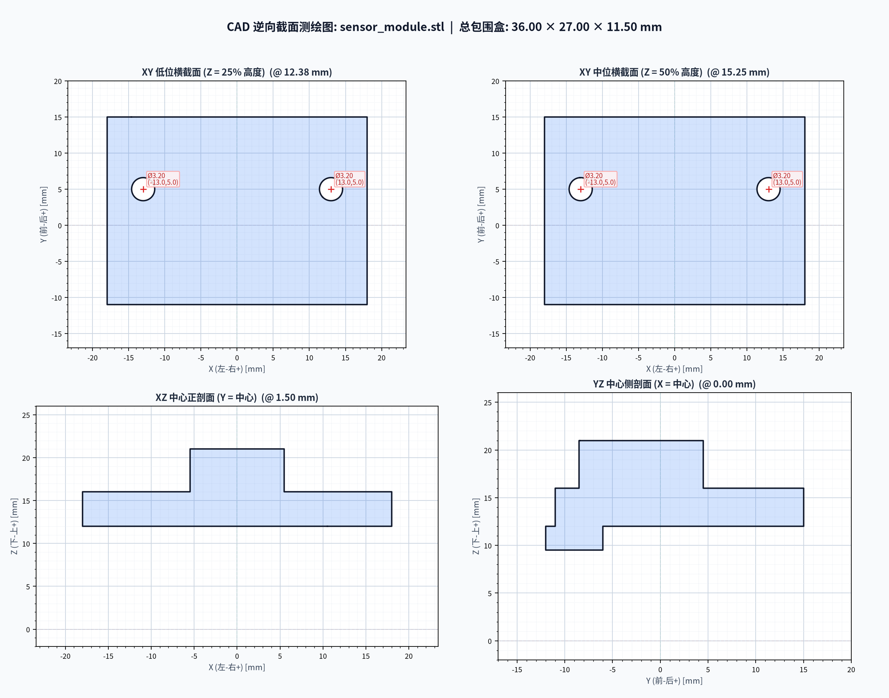
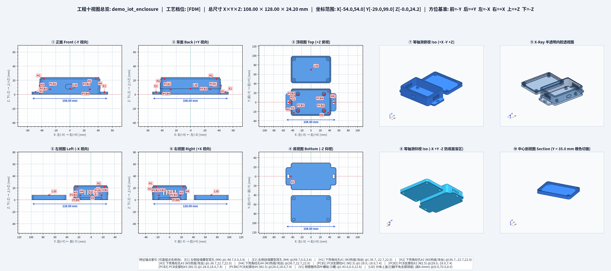
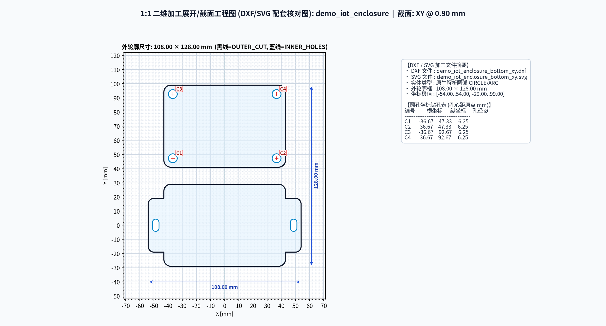
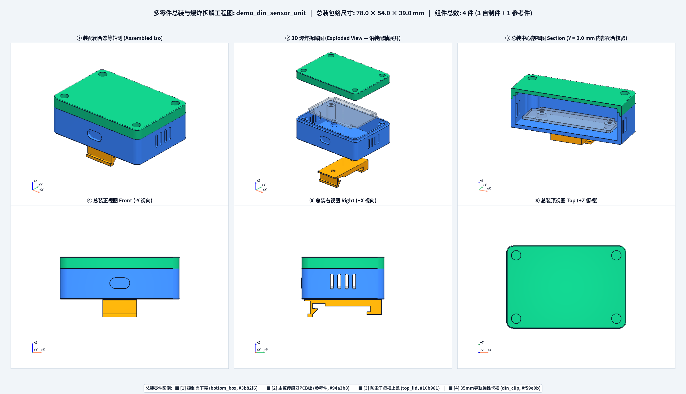
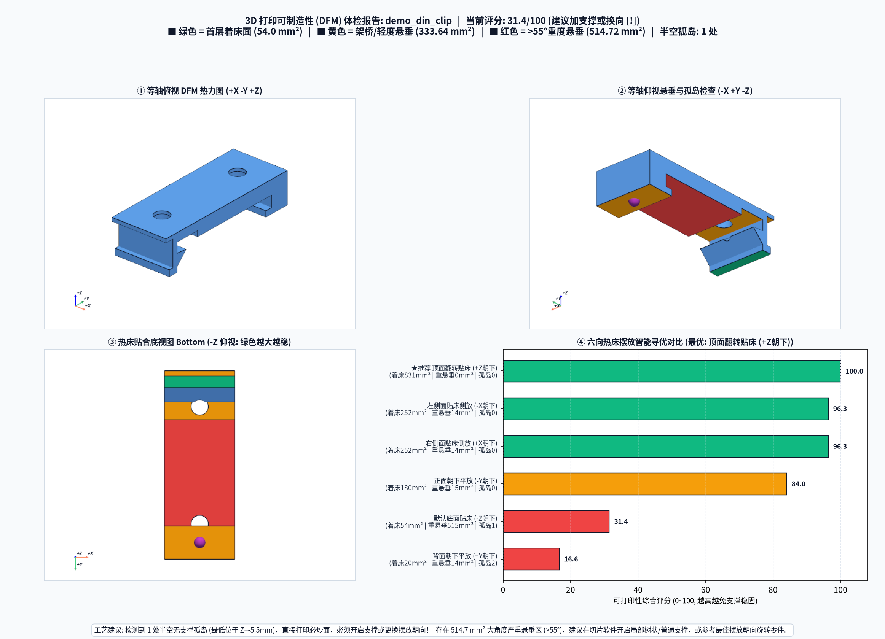

# CAD Studio — Agentic 结构件参数化建模工作站

专为 **AI Agent + 工程师协作设计 STEP / STL 结构件** 打造的独立工作区。内置统一语义坐标协议、双工艺公差引擎（**FDM 3D 打印 / CNC 机加工 / 理论零公差**）、STEP/STL 逆向测绘探针、**10 视图工程总览图**、**修改前后红绿三维 Diff 对比** 以及 **零依赖 WebGL 实时剖切 3D 预览器**。

---

## 一、 核心能力一览

1. **STEP + STL 原生双输出 (`build123d` + `OpenCASCADE`)**：
   - 真 B-Rep 实体建模，导出的 `.step` 可直接拖入 `BambuStudio`（圆弧丝滑无折面）或 SolidWorks / FreeCAD 二次装配；同步导出水密 `.stl`。
2. **参考/修改现有文件 (`cad-cli inspect` + `modify_mesh`)**：
   - 丢入任意现成 `.step` 或 `.stl`，自动提取**包围盒极值、原点偏移警告、各台阶平面高度、圆孔坐标与直径**，并输出 **4 视图毫米标尺截面图**。
   - 支持 **STEP 实体二次布尔改件**、**STL 水密网格开孔/加耳片手术**、**STL 逆向参数化重构转 STEP**，以及**配合件三维干涉防撞检测**。
3. **10 合 1 工程总览图 + 红绿 Diff 图 (`preview_sheet.png` & `diff_sheet.png`)**：
   - **正交六视图**（前、后、顶、底、左、右，零透视畸变 + `1mm/5mm/10mm` 标尺 + 特征 ID 红牌）+ **俯仰双等轴测** + **X-Ray 半透明内腔透视** + **橙色中心实心剖视图**。
   - 每次迭代修改自动生成 **红绿布尔对比图**（🟢 绿色 = 新增体积，🔴 红色 = 切除体积，⚪ 灰透 = 保留区）。
4. **更快更准听懂你的口语修改 + WebGL 指哪打哪 / 3D 数字卡尺 (`v0.2`)**：
   - 全项目锁死方位映射：**前=`-Y` ｜ 后=`+Y` ｜ 左=`-X` ｜ 右=`+X` ｜ 上=`+Z` ｜ 下=`-Z`（热床 `Z=0`）**。
   - 每个孔、槽、柱自动注册短编号（如 `[H1]`, `[S1]`, `[B1]`, `[R1]`）投影在图上，可直接点名修改。
   - **`viewer.html` 射线拾取 + 两点 3D 卡尺**：在 3D 预览器中**单击任意表面、内腔剖面、锐边端点或孔心**，直接生成带精确 `(x, y, z)` 毫米坐标与法向朝向的修改口令，一键复制粘贴发给 Agent；支持两点精确测距（总距 `L` + `|ΔX|, |ΔY|, |ΔZ|` 分量）。
5. **工业高频结构母版库 + 1:1 激光切割/CNC `DXF / SVG` 导出 (`v0.2`)**：
   - 内置 **分体式上下盖电子外壳母版**（子母止口 Lip&Groove、四角热熔螺母柱、PCB 支撑柱、散热百叶、挂墙耳、USB-C/DC 面板开孔）、**2020/3030/4040 欧标铝型材防转角码与转接板**、**35mm DIN 导轨快拆弹性卡扣**、**真渐开线正齿轮 / D轴孔 / 608 轴承座**。
6. **3D 打印可制造性 (DFM) 扫描 + 6 向智能最佳摆放 + 原生 `.3mf` (`v0.3`)**：
   - 自动检测 **半空无支撑孤岛（必炒面预警）**、**`>55°` 重度悬垂区** 与 **首层热床着床面积**，自动评估 `±X / ±Y / ±Z` 六个朝向评分并支持 `--auto-orient` 一键旋转到最佳免支撑姿态导出命名彩色 `.3mf`。
7. **多零件总装系统 (`Assembly`) + 动态爆炸滑块 + 紧固件 BOM 清单 (`v0.3`)**：
   - 支持多件彩色总装、**N×N 全矩阵三维碰撞与最小表面间隙体检**、**6 视图爆炸拆解与彩色剖面图**、自动统计耗材克重与紧固件采购 BOM，并一键生成**自动滤除参考件、自动翻平排好盘的 `<name>_print_plate.3mf`**。
8. **热驻留 MCP Server + 全局 Antigravity Plugin + 原子级无损改参 (`v0.4`)**：
   - 内置常驻内存的 **`cad-studio-mcp` 服务**（共享离屏 OpenGL 上下文复用，免除每次 `OpenCASCADE + VTK` 冷加载，热改参出图提速数倍）与一键全局插件安装器 `uv run cad-cli install-plugin`；
   - 提供 AST 级无损改参 `set-param` / `cad_set_params`（保留源码中文注释，零语法错误风险）、全局索引 `status`、标准件速查 `lookup`、OCCT 中文报错定位，以及顶点索引压缩版 `viewer.html`。
9. **百兆级超大 STEP / STL 涡轮加速与水密瘦身引擎 (`v0.5`)**：
   - **三级自动 LOD 管线 + `.cad_cache/` 磁盘缓存**：百万面级模型在 WebGL 预览层（`<=35k` 面，`0.1s` C++ 聚类降采样）、十视图渲染层（`<=120k` 面）、干涉/截面分析层（`<=160k` 水密面）自动分级处理，二次热加载仅需 `~15ms`，绝不撑爆网页或内存；
   - **整机/PCB `.step` 微小碎块自动剥离 + 36 核并行三角化**：自动剔除大型装配体中 `<2.0mm` 的贴片电阻/螺纹碎块并保留核心壳体与安装孔；
   - **`cad-cli optimize` / `cad_optimize_file`**：一键将臃肿的百兆级 STL/STEP 误差受控水密简化、局部包围盒（`--roi`）裁剪并转存为高压缩 `.3mf`（体积缩减 `85%~98%`），附带 `>45MB` GitHub 大文件越界预警。

---

## 二、 实测渲染预览（内置 `demo_sensor_bracket` 演示件）

### 1. 工程十视图总览 (`preview_sheet.png`)


### 2. 修改前后红绿三维布尔对比 (`diff_sheet.png`)


### 3. 现有 STL/STEP 逆向截面测绘 (`sensor_module_inspect_slices.png`)


### 4. 上下分体电子控制盒母版 (`demo_iot_enclosure/out/preview_sheet.png`)


### 5. 1:1 激光切割 / CNC 原生圆弧 DXF 配套核对图 (`demo_iot_enclosure_bottom_xy_2d.png`)


### 6. 多零件总装、3D 爆炸拆解与彩色中心实心剖视图 (`demo_din_sensor_unit/out/assembly_sheet.png`)


### 7. 3D 打印悬垂/半空孤岛热力图与六向智能摆放评分 (`demo_din_clip_printability_sheet.png`)


---

## 三、 日常使用方式（直接对 Agent 说话即可）

克隆仓库并在 Antigravity 中将工作区打开到本仓库根目录 `cad-studio`（会自动加载 `AGENTS.md` 规则与 `.agents/skills/structural-cad` 技能）：

- **从零画件**：
  > “帮我画一个 42 步进电机（NEMA17）L 型固定支架，FDM 打印用，底座用 4 个 M4 腰型调节孔，两侧加加强筋。”
- **参考或修改现有 STL/STEP**：
  > “参考 `refs/board.step`，给它设计一个带卡扣或 M3 热熔螺母柱的下壳，正面留 Type-C 开口，确保不干涉。”
  > “把 `refs/old_part.stl` 拿过来，在底面右侧多加一个 M3 安装耳片，背面中间开个 Ø10 过线孔。”
- **看图极速改件**：
  > “看了一下预览图：把 `H1` 和 `H2` 往前移 2mm，`S1` 开口放宽到 18mm，另外帮我切一份 CNC 攻丝公差版本的 STEP。”

---

## 四、 命令行工具速查 (`cad-cli`)

首次克隆后执行 `uv sync`（自动拉取 Python 3.12 环境及依赖），随后即可运行：

```bash
cd cad-studio
uv sync

# 0. 一键安装为本机全局 Antigravity Plugin（自动挂载热驻留 cad-studio-mcp 工具服务，跨工作区随处可用！）
uv run cad-cli install-plugin

# 0.5 全局项目状态速览 / AST 原子无损改参构建 / 标准件速查
uv run cad-cli status
uv run cad-cli set-param projects/demo_sensor_bracket/part.py front_slot_w=18.0 --build
uv run cad-cli lookup M3

# 1. 新建零件工作目录（支持 --template: basic | enclosure | extrusion-bracket | din-clip | gear）
uv run cad-cli init-part my_box --template enclosure --mode fdm
uv run cad-cli init-part corner_2020 --template extrusion-bracket

# 2. 构建零件（自动输出 .step, .stl, preview_sheet.png, diff_sheet.png, 带点选/卡尺的 viewer.html，加 --dxf 同步出 2D 图纸）
uv run cad-cli build projects/demo_sensor_bracket/part.py --dxf bottom
uv run cad-cli build projects/demo_iot_enclosure/part.py --dxf bottom
uv run cad-cli build projects/demo_sensor_bracket/part.py --mode cnc   # 切换 CNC 公差档位构建

# 3. 3D 打印可制造性体检（悬垂/半空孤岛热力图 + 6向智能最佳摆放寻优 + 自动换向导出 .3mf/.step）
uv run cad-cli print-check projects/demo_din_clip/part.py --auto-orient

# 4. 多零件总装构建（N×N 全矩阵碰撞/最小间隙体检 + 爆炸图 + 紧固件 BOM + 自动排盘 .3mf + WebGL 爆炸滑块）
uv run cad-cli init-assembly my_device_unit
uv run cad-cli build-assembly projects/demo_din_sensor_unit/assembly.py

# 5. 独立导出任意 STEP / STL / part.py 的 1:1 激光切割/CNC 二维图纸 (.dxf + .svg + 钻孔坐标表图)
uv run cad-cli export-2d projects/demo_sensor_bracket/out/demo_sensor_bracket.step --face back

# 6. 超大 STEP / STL 模型瘦身、剥离微小元件与局部关注区 (ROI) 裁剪
uv run cad-cli optimize huge_scan.stl --tol 0.03 --format 3mf
uv run cad-cli optimize full_pcb.step --min-solid-diag 2.0 --roi -40,40,-30,30,0,25 -o refs/pcb_slim.3mf

# 3. 逆向体检任意现有 STEP / STL 文件
uv run cad-cli inspect projects/demo_sensor_bracket/refs/sensor_module.step --preview

# 4. 对比任意两个新旧模型的三维体积差异
uv run cad-cli diff old.stl new.stl -o diff_sheet.png

# 5. 一键用本机 BambuStudio 打开生成的 STEP 或 STL
uv run cad-cli open-slicer projects/demo_sensor_bracket/out/demo_sensor_bracket.step
```

---

## 五、 目录结构说明

```text
cad-studio/
├── AGENTS.md                        # 常驻全局规则：方位协议、参数化铁律、视觉+几何双重自检闭环
├── pyproject.toml                   # Python 3.12 独立环境配置 (build123d, pyvista, trimesh, manifold3d)
├── .agents/skills/structural-cad/   # Antigravity 结构件专项 Skill 与工程速查手册
│   ├── SKILL.md
│   ├── references/
│   │   ├── fasteners_and_tolerances.md
│   │   └── build123d_cookbook.md
│   └── scripts/run_cli.sh
├── cad_kit/                         # 核心 Python 标准件与渲染引擎库
│   ├── tolerances.py                # FDM / CNC / Exact 三模公差与 M1.6-M8 紧固件表
│   ├── features.py                  # 特征锚点注册器 + 沉头/热熔螺母/螺母槽/腰型孔/加强筋生成器
│   ├── inspector.py                 # STEP 拓扑孔位识别 + STL 截面圆拟合测绘器
│   ├── mesh_ops.py                  # 基于 manifold3d 的现有 STL 水密布尔修改工具
│   ├── verify.py                    # 实体连通性、水密性与参考件三维干涉碰撞检测
│   ├── renderer.py                  # 10视图工程蓝图渲染器 + 红绿布尔体积 Diff 渲染器
│   ├── viewer_html.py               # 零外部 CDN 的 WebGL 实时剖切交互式 3D 预览生成器
│   └── cli.py                       # cad-cli 统一入口
└── projects/                        # 各独立结构件项目目录
    └── demo_sensor_bracket/         # 内置完整演示项目（含参考件测绘、L型支架、修改对比与交互预览）
```
